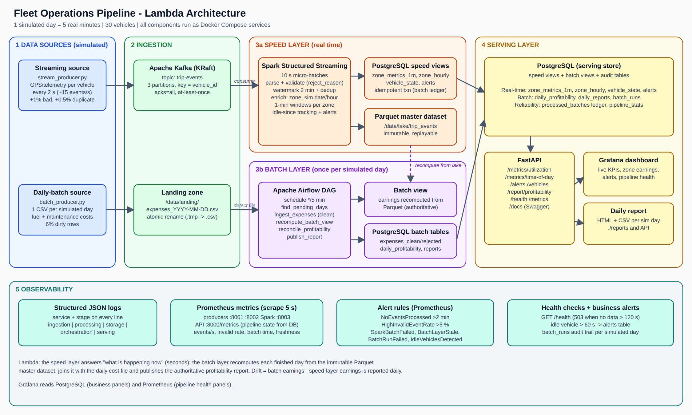

# Fleet Operations Pipeline (Lambda architecture)

Ride-hailing fleet: live utilization from a Kafka telemetry stream (speed layer) reconciled every simulated
day against garage/fuel cost files (batch layer, Airflow) into a per-vehicle profitability report.



| Layer | Tool | What it does |
|---|---|---|
| Sources | Python simulators | `stream_producer.py` (30 vehicles, 1 event / 2 s, injects 1 % bad + 0.5 % duplicate events); `batch_producer.py` (1 CSV per simulated day, 6 % dirty rows) |
| Ingestion | Apache Kafka (KRaft) | topic `trip-events`, 3 partitions, key = `vehicle_id` |
| Speed layer | Spark Structured Streaming | validate, dedupe (watermark), enrich (zone), 1-min windows, idle tracking, alerts -> PostgreSQL + Parquet |
| Batch layer | Apache Airflow | daily DAG: clean expenses, recompute earnings from Parquet, join with costs, classify, publish report |
| Serving | PostgreSQL + FastAPI (+ Grafana) | real-time API, alerts, reports, dashboard |
| Observability | JSON logs, Prometheus, alert rules, `/health` | see below |

**Simulated clock:** 1 simulated day = **5 real minutes** (1 simulated hour = 12.5 s). The clock's start is stored in
the `sim_clock` table when the database is created, so every container agrees on the date.

## Quick start

Requirements: Docker Desktop (>= 6 GB RAM allocated), Git. Nothing else.

```bash
docker compose up --build -d          # first build takes 10-20 min (downloads images + Spark JARs)
docker compose ps                     # wait until everything is Up / Exited(0) for the *-init services
```

| URL | What |
|---|---|
| http://localhost:8000/docs | API (Swagger) - try `/metrics/utilization`, `/alerts`, `/report/profitability` |
| http://localhost:3000 | Grafana dashboard "Fleet Operations" (admin / admin) |
| http://localhost:8080 | Airflow (admin / admin) - DAG `daily_fleet_reconciliation` |
| http://localhost:9090/alerts | Prometheus alert rules |
| http://localhost:4040 | Spark UI |
| `localhost:5433` | PostgreSQL (db `fleet`, user/password `fleet`) |

Stop: `docker compose down`. Full reset (new simulated clock, empty data): `docker compose down -v`.

## Reproducing the results (demo script)

1. `docker compose up --build -d`; wait ~2 minutes. `curl localhost:8000/health` -> `{"status":"ok"}`.
2. **Real-time:** `curl localhost:8000/metrics/utilization` (active vehicles, idle ratio, trips per simulated hour, earnings by zone).
3. **Alert:** after ~2-3 minutes vehicles V027-V030 (the "lazy" ones) are idle > 60 s: `curl localhost:8000/alerts`.
4. **Daily report:** the first expense file drops when the first simulated day ends (<= 5 min). Airflow picks it up on its next 5-minute run (up to ~10 min after start): `curl "localhost:8000/report/profitability"`, or open `http://localhost:8000/report/profitability?format=html`, or look in `./reports/`.
   The first day is usually *partial* (the stream started mid-day) - the report says so. From the second day on the report is complete; V024-V026 ("costly") show as UNPROFITABLE.
5. **Observability demo:**
   - `docker compose stop stream-producer` -> after ~2 min `NoEventsProcessed` fires at http://localhost:9090/alerts and `/health` returns 503. `docker compose start stream-producer` recovers it.
   - Set `BAD_EVENT_RATE: "0.08"` for `stream-producer` in `docker-compose.yml`, `docker compose up -d stream-producer` -> `HighInvalidEventRate` fires.
   - `docker compose logs -f spark-streaming` shows structured JSON logs (`batch committed`, `invalid events rejected`).
   - **Crash recovery:** `docker compose kill spark-streaming` then `docker compose up -d spark-streaming` - Spark resumes from its checkpoint; the `processed_batches` ledger prevents double counting.
6. Force a report immediately (demo shortcut): `docker compose exec batch-producer python -m simulators.batch_producer --drop-now`
   then trigger the DAG in the Airflow UI (it only processes days that are finished + 20 s grace; use *Trigger DAG w/ config* `{"reprocess": ["<date>"]}` to force a day).

## Where each requirement lives

| Requirement | Code |
|---|---|
| Streaming source | `simulators/stream_producer.py`, `simulators/vehicle.py` |
| Daily-batch source | `simulators/batch_producer.py` |
| Kafka producers/topics/partitions | `docker-compose.yml` (`kafka-init`), key = vehicle_id in `stream_producer.py` |
| Stream processing | `streaming/transforms.py` (logic), `streaming/spark_job.py` (wiring), `streaming/sinks.py` (DB writes) |
| Orchestration | `airflow/dags/daily_reconciliation.py`, `common/batch_tasks.py`, `common/batch_logic.py` |
| Storage | PostgreSQL schema `db/init/02_schema.sql`; Parquet in the `lake` volume |
| Serving | `api/main.py` |
| Structured logging | `common/logging_utils.py` (JSON, `service` + `stage` on every line) |
| Metrics + alerts | `/metrics` on every service, `monitoring/prometheus.yml`, `monitoring/alert_rules.yml`, `/health`, `alerts` table |
| Tests | `tests/` |

## Key design decisions (short)

* **Lambda, not Kappa:** two very different inputs (a continuous stream and a once-a-day cost file) and a daily
  reconciliation that must be recomputable and correctable. The batch layer recomputes each finished day from the immutable
  Parquet master dataset and reports `drift` versus what the speed layer accumulated. See `docs/REPORT_GUIDE.md`.
* **Earnings** = sum of `fare` on events with `trip_completed = true` (added field; on-trip events carry the metered fare).
* **Exactly-once effect:** Spark is at-least-once; each micro-batch is written in one DB transaction guarded by the
  `processed_batches` ledger, and Parquet is written to `batch_id=<n>` folders with overwrite, so replays are harmless.
* **Idle alert:** vehicle continuously idle for `IDLE_ALERT_SECONDS` (60 real seconds ~ 4.8 simulated hours), measured on
  event time; one open alert per vehicle, auto-resolved when it starts working.

## Assumptions and simplifications (state these in the report)

* Time compression 1 day = 5 min, so trips last 15-40 real seconds. Trip durations/fares are not realistic, only their relative shape.
* Spark runs in **local mode** in one container (not a cluster); Kafka is a single broker (replication factor 1).
* Zones are a 3x3 grid over a bounding box around Colombo, not real polygons.
* Currency is LKR; fares and costs are random but calibrated so that normal vehicles are profitable and V024-V026 are not.
* Vehicle master data = vehicles seen on the stream (used to reject unknown vehicle ids in expense files).
* The first simulated day after a fresh start is partial (flagged in the report).
* Small Parquet files (one folder per 10 s micro-batch) are fine for a demo; production would compact them.
* No Alertmanager: alert rules are visible in Prometheus/Grafana; production would route them to Slack/e-mail.

## Running the tests

```bash
python -m venv .venv && .venv\Scripts\activate      # Windows   (Linux/macOS: source .venv/bin/activate)
pip install -r requirements-dev.txt
pytest                                               # unit tests (Spark tests need Java 17, DB tests need Postgres)
# database tests: point at the Postgres from docker compose (uses throw-away databases, your data is safe)
set TEST_PG_ADMIN_DSN=host=localhost port=5433 user=fleet password=fleet dbname=fleet     (PowerShell: $env:TEST_PG_ADMIN_DSN="...")
pytest
```

## Troubleshooting

* `docker compose ps` shows a service restarting -> `docker compose logs <service>`.
* Spark container exits quickly -> not enough memory; raise Docker Desktop memory to >= 6 GB.
* Ports in use -> change the left side of the mapping in `docker-compose.yml`.
* Linux: `./reports` not writable by Airflow -> `chmod 777 reports` (the report is still served by the API).
* Changed the schema or want a clean start -> `docker compose down -v` (init scripts only run on a fresh volume).
* Never delete only the Spark checkpoint: Spark would re-read all of Kafka and double count. Use `docker compose down -v` for a clean reset.
